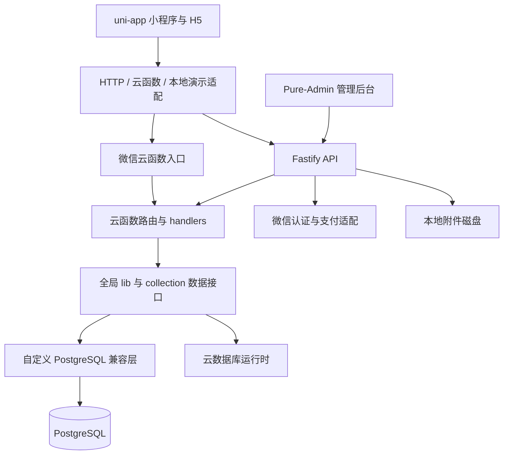
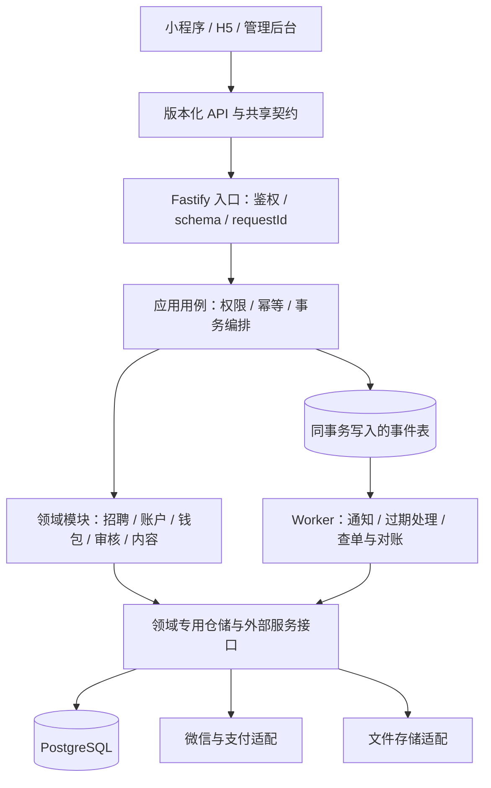

# 管焊圈架构评审与演进建议

日期：2026-11-13。评审基线：`90a2df9`，结合当前工作区。性质：静态架构评审与候选演进方案，尚未实施。

后续实施记录：用户确认后已完成部分首轮改造，详见 [架构优化第一版](架构优化第一版.md)。本文保留评审时的发现与完整候选路线，不代表所有建议均已落地。

本次通过 Graft 图谱定位，再读取 API、数据库、支付、审核、报名、评价、文件与前端关键代码。图谱未完整索引 Vue 页面及动态导出，因此对相关页面和 handler 补充了定点读取。没有执行或修改测试，没有压测，没有验证生产流量、真实支付与线上部署。文档中的风险是代码路径分析，不代表已经发生线上事故。未获得团队规模、业务量和可用性目标，暂以可靠上线及长期维护为优先。

## 1. 结论与保留项

建议目标是：**TypeScript 模块化单体 + 按业务用例划分事务 + PostgreSQL + 独立后台任务进程 + 契约驱动的双端前端**。业务模块清晰后，再根据负载和团队边界选择性拆服务。

现有项目已具备有价值的基础：关系表、外键、唯一约束、条件扣款、迁移校验和、支付验签与重复通知处理、管理员写操作审计、私有文件签名访问，以及前端共享组件和内容字典。应逐步演进，避免一次性重写导致这些保障丢失。

当前主要欠缺是业务边界、契约、状态迁移与运行治理。更换框架本身不能解决这些问题。

| 路线 | 收益 | 成本和限制 | 判断 |
|---|---|---|---|
| 在原结构上局部修补 | 最快修正明确问题 | 双运行时、全局状态、协议与领域耦合继续存在 | 适合第一批止损 |
| 模块化单体，逐模块替换旧实现 | 保留现有部署，形成领域边界，可逐步移除全局锁 | 需要设计契约和迁移顺序 | 推荐主路线 |
| 全面微服务化 | 独立部署与扩容能力强 | 分布式事务、网络故障、权限传播和运维成本增加 | 等独立负载或团队边界有证据后再选 |

## 2. 当前架构



独立后端目前同时承担协议转换、身份校验、文件转换、全请求事务、审计和旧路由转发。业务核心仍放在 `cloudfunctions/api/handlers`，数据访问依赖模拟云数据库的 API。这个设计降低了迁移成本，但兼容层已经成为长期架构的核心依赖。

## 3. 优先处理的问题

优先级定义：P0＝在对应真实收费或核心运营场景启用前处理；P1＝下一阶段结构演进重点；P2＝随规模和业务投入推进。优先级并非线上事故等级。

### 3.1 P0：财务与运营统计存在硬截断

证据：`cloudfunctions/api/handlers/admin.js:569`，财务汇总取最近 2000 条流水、最多 1000 条已支付订单，再在内存求和。`admin.js:100` 的日/月活用户取数分别限制 2000/5000；`admin.js:147` 的岗位分布最多取 1000 条。

影响：超过阈值后，名为总额、总量的指标会少算。日/月活采用最近登录时间，不能准确表示持续使用但没有重新登录的活跃用户。积分与余额若进入同一业务汇总，也应明确区分计量单位。

建议：财务统计使用数据库全量条件聚合，明确时间范围、币种和积分单位；大报表使用按日汇总表。活跃数据来自使用事件，定义北京时间日界、去重规则、统计延迟。报表返回统计口径和数据更新时间。

完成标准：超过原取数上限仍按全量统计；流水、订单和账户余额有可解释的对账关系。

### 3.2 P0：收费操作缺少统一的请求幂等

证据：`cloudfunctions/api/handlers/social.js:130` 每次购买保险都会扣余额并新增购买记录；`jobs.js:376` 每次刷新都会扣积分。`server/payment.cjs:26` 已处理充值回调重复，但这不等于客户端购买、刷新和下单都有请求幂等。

影响：一次操作成功、响应丢失、客户端重试时，可能被当作另一笔购买或扣费。全局锁只串行执行，无法识别重复业务意图。

建议：引入请求幂等键，唯一范围为“主体 + 操作 + 幂等键”，保存请求摘要、处理状态、业务单号及结果。相同键不同参数拒绝；相同请求返回原结果；真正的新购买使用新键。扣款、业务记录、幂等结果同事务提交，资金流水按独立业务交易 ID 关联。

### 3.3 P0：审核缺少状态迁移和版本控制

证据：`cloudfunctions/api/handlers/admin.js:189` 读取岗位存在后直接写入通过/驳回，没有要求原状态为待审核，没有匹配内容版本；`pass` 用布尔强转解析。

影响：旧审核请求可能覆盖已下架或已删除状态；审核员打开旧内容后，可能误审用户刚修改的新版本。重复提交也会重复写通知。

建议：建立岗位状态迁移表与审核记录。提交审核绑定 `contentVersion`，审批采用 `WHERE id = ? AND status = pending AND version = ?`，冲突返回明确的 409。重新上架与审核通过应是不同命令。请求 schema 必须要求真正的 boolean。

### 3.4 P1：全局事务锁把主要请求串行化

证据：`server/routes/api.cjs:59` 将旧路由调用包进默认写事务；`server/db/index.cjs:142` 使用固定 advisory lock；`index.cjs:204` 的事务默认 `write = true`。

影响：列表、后台统计、账户更新等互不相关的业务可能争用同一把锁。扩充连接池或增加 API 实例不会消除该数据库瓶颈。目前没有压测，不能给出真实吞吐上限。

建议：先明确每条命令的一致性约束，使用账户/订单/岗位级行锁、条件更新、唯一约束和乐观锁。统一多对象加锁顺序，避免死锁。完成一个领域的并发控制后，才移除该领域的全局锁；禁止直接删除全局锁后寄希望于事务自动解决业务竞争。

### 3.5 P1：查询带副作用，岗位有效性规则没有集中

证据：`cloudfunctions/api/handlers/jobs.js:59` 的 `sweepExpired` 在列表、详情等读取入口更新过期记录；`jobs.js:165` 在详情读取时增加浏览量。`applications.js:5` 报名只校验 `status === 1`，没有直接判断 `expireAt`。

影响：查询难以缓存；已到期但尚未被扫描更新的岗位，直接提交报名仍可能通过状态检查。

建议：将 `isRecruitable(now)` 作为报名等命令的统一领域规则；读取使用明确的有效期条件；后台任务分批更新过期状态及生成通知。展示正确性不能依赖任务准时运行。浏览事件独立采集并去重/聚合，不能把多次请求直接视作独立用户浏览。

### 3.6 P1：云函数与独立后端的规则可能分叉

证据：`server/routes/api.cjs:1` 导入云函数路由；`server/build.cjs:6` 修改全局数据库引用和 `process.env`；`cloudfunctions/api/lib.js:3` 保存模块级可变状态。Fastify 路径提供事务、管理员启用状态检查和审计；`cloudfunctions/api/index.js:35` 直接调用旧路由。旧路由管理员鉴权 `router.js:185` 主要验证签名，存在默认密钥回退表达式。

影响：两条入口共享函数，但事务和安全策略不完全相同。一个进程构建不同配置实例也会覆盖全局依赖。这里只确认代码路径差异，不推断线上实际启用了默认密钥。

建议：确定唯一主后端。以 PostgreSQL 为主时，云函数逐步成为薄入口或退役；若必须支持两种运行时，统一调用框架无关的领域服务，并为适配器定义等价能力。依赖通过实例构造注入，启动时一次性读取配置，禁止业务运行时改写环境变量，生产配置缺失直接启动失败。

### 3.7 P1：接口契约与错误模型薄弱

证据：`server/routes/api.cjs:38` 的动态路由没有统一 request/response schema；业务验证分散在 handlers。`cloudfunctions/api/router.js:195` 的安全错误分支返回通用错误，但没有记录原异常；同一分支将所有 TypeError 映射为 400，可能掩盖编程错误。`admin/src/api/guanhanquan.js:12` 将失败统一转换为只有 message 的 Error。

建议：采用 Fastify JSON Schema 与 TypeBox 类型推导，生成 OpenAPI 和双端客户端；迁移时兼容旧响应。错误同时包含稳定业务码、HTTP 状态、requestId 和安全的字段错误。已知业务失败显式建模，未知异常保留服务端堆栈并脱敏记录。前端按错误码处理登录、余额不足、版本冲突和重试。

### 3.8 P1：权限与审计尚不能支持运营团队分工

证据：`server/security.cjs:13` 只接受角色为 `super` 的有效管理员；`server/db/001_initial.sql:27` 角色缺少权限关联；`server/routes/api.cjs:80` 审计主要记录操作者、方法、路径、目标。

建议：设计审核员、内容运营、客服、财务、管理员权限矩阵，在后端执行操作与数据范围授权；前端菜单只负责展示。审计补充原因、请求 ID、资源版本、脱敏的前后差异。资金调整与敏感导出设置独立权限；确有业务需要时引入双人复核。

### 3.9 P1：附近岗位和地区检索需要结构化

证据：`cloudfunctions/api/handlers/jobs.js:224` 只从最多 200 条岗位计算附近距离，可能遗漏其他更近岗位；`jobs.js:112` 把行政编码转换为地址文本正则；`server/db/001_initial.sql:50` 主要保存 `work_area` 文本。

建议：保存省市区编码与展示地址，老数据逐步回填并保留原文。附近检索在数据库做地理过滤和排序，地理查询成为重要入口时引入 PostGIS 与 GiST 索引；列表采用与排序匹配的复合索引和游标分页。中文全文检索需要单独评估分词效果，不能假设 PostgreSQL 默认分词即可满足。

### 3.10 P1：评价缺少真实业务关系约束

证据：`cloudfunctions/api/handlers/social.js:4` 校验评价对象和分值后直接写入，没有验证双方招工关系、参与状态、重复评价或自评；`social.js:24` 平均分只使用最近 50 条。

建议：把评价绑定报名或履约关系，限定参与双方、每阶段一次评价、可修改窗口和申诉流程。评分按明确口径聚合，并区分关系已核验与未核验反馈。黑名单与纠纷处理建立证据、处置、申诉和撤销历史。

### 3.11 P1：支付完成不等于支付运营闭环

证据：`server/payment.cjs:4` 已先保存 pending 订单，再调用外部支付；`:26` 已验证订单并幂等入账。`docs/PostgreSQL后端设计与接入.md:49` 明确主动查单、关单、定时对账仍待补充。

建议：增加支付尝试、超时查单、关单、异常单处理、账单对账；退款按实际产品政策建模。余额与积分分开定义资产类型，货币采用整数分或 Decimal 并贯穿传输、业务计算与存储；当前数据库 numeric 转 JS Number（`server/db/index.cjs:49`）不应成为统一金额契约。实际经营余额业务时建议建设不可变账务分录、冲正和余额核对，后续结算复杂再发展双分录账本。

### 3.12 P1：账户注销缺少跨领域生命周期

证据：`cloudfunctions/api/handlers/auth.js:178` 注销主要禁用用户并清空手机、昵称、头像，未在该流程编排岗位、简历、报名联系快照和附件的处理。

建议：分别定义禁用、注销申请、注销完成。梳理关联数据，停止公开展示或访问，处理未完成业务；历史账务按明确留存策略保存，并对不需继续保留的个人信息做脱敏或清理。使用可恢复任务记录每一步，避免只修改用户主表就宣称完成。

### 3.13 P2：前端已有抽象，但复用和类型覆盖不一致

证据：首页 `app/src/pages/index/index.vue:265` 与搜索页 `jobSearch.vue:284` 各自实现请求序号、分页和错误状态；后台 `usePagedList.js:3` 已提供竞态保护，但 `Jobs.vue:88` 仍自行请求且没有序号保护。`admin/tsconfig.json:6` 关闭 strict，并排除 JS；业务 API 与多个业务页面仍为 JS。

建议：按业务组织 `features/jobs`、`features/applications`、`features/wallet`；页面负责编排，共用列表请求、表单草稿、鉴权与提交状态 composables。复用现有组件与语义令牌。新业务优先 TypeScript strict，旧代码逐模块迁移，不强制连带重构 Pure-Admin 上游框架。业务枚举由 contracts 共享，运营标签继续由服务端维护。

具体规则偏差：`app/src/components/job-form.vue:452` 仍通过 `[7, 15, 30][validIndex]` 得到业务值，与本仓库禁止按选项位置生成业务值的规范不一致，应改为选项对象的稳定 value。

### 3.14 P2：附件和可观测性需为多实例做好边界

证据：`server/files.cjs:80` 附件写本地磁盘；`:41` 响应转换逐文件检查引用权限；`server/app.cjs:25` 有基础错误日志，`:13` 限流使用默认进程内实现；`server/build.cjs:13` 设置 `trustProxy: false`。

建议：抽象文件存储接口，初期保留磁盘部署，扩展时迁到对象存储私有桶；保留签名与资源授权、补充孤立附件清理、数据库和文件一致的备份恢复方案。文件权限按显式资源关联检查并批量加载，避免通用遍历带来的大量查询。记录请求延迟、错误率、数据库锁等待、连接池占用、待处理支付与任务积压。反向代理上线时明确可信代理边界，否则按 IP 限流可能把所有请求识别成代理地址；多实例时再共享限流状态。

### 3.15 P2：工程治理与文档存在漂移

证据：app/server 使用 npm 锁，admin 使用 pnpm 锁；本次未发现仓库内 `.github` CI 工作流，不能据此断言外部没有 CI。旧交付报告仍描述“区县不参与过滤”，现有代码已支持 regionCode 转换过滤。Graft 当前索引对 Vue 与动态导出覆盖有限。

建议：确定包管理器、固定 Node 与包管理器版本，建立 workspace；暂时允许 uni-app 与后台使用不同 Vue/Vite 版本。统一 lint、类型检查、构建和依赖边界检查，在明确授权后接入测试门禁。把历史验收记录标记为对应版本，当前部署和架构以 ADR、接口契约与迁移文件为准。图谱作为发现入口，对未索引文件保留补充审查路径。

## 4. 推荐目标架构



采用轻量读写分离：命令维护约束，查询直接使用专用 SQL/read model；初期仍共用 PostgreSQL，不额外建立读库或消息中间件。

Outbox 的含义是“业务数据与待发送事件同事务保存”，Worker 重试发送。它提供至少一次投递，需要消费者幂等，不能声称天然实现精确一次。通知失败不能撤销已成功完成的报名；余额变化等核心约束继续同步事务完成。

建议模块边界：

| 模块 | 拥有的规则和数据 | 对其他模块的接口 |
|---|---|---|
| identity | 用户、登录身份、管理员、权限、会话、注销 | Actor、权限检查 |
| recruitment | 岗位、简历、报名、状态迁移、招聘结果 | 发布、报名、接受、确认到岗 |
| wallet | 积分、余额、交易、账务记录、收费规则 | 扣费、入账、冲正、查询余额 |
| payments | 外部支付订单、查单、回调、对账 | 产生已支付事件、关联账务交易 |
| moderation | 内容审核、认证、举报、申诉、审核历史 | 审批决定及资源版本 |
| reputation | 评价资格、评分、争议和信用记录 | 可评价判定、可信评分 |
| content | 字典、工种、轮播、公告、发布版本 | 已发布内容快照 |
| services | 培训报名、保险订单与实际交付状态 | 服务订单、履约结果 |
| platform | 文件、任务、审计与基础观测 | 基础设施接口，不吸收业务逻辑 |

模块内采用 `routes/schema → application → domain → repository ports`，适配层实现这些接口。跨模块通过公开用例或事件通信，不直接改别人的表。查询报表允许有明确归属的跨表读取，但不得反向承载写业务规则。

候选目录仅供后续实施设计，不要求现在搬动全部项目：

```text
app/                         # 保留 uni-app
admin/                       # 保留 Pure-Admin
server/src/
  modules/recruitment/
    domain/                  # 状态与业务不变量
    application/             # ApplyJob、ReviewJob 等用例
    infrastructure/          # PostgreSQL 仓储
    interfaces/http/         # 路由、schema 与 DTO
  modules/wallet/
  modules/identity/
  platform/
  bootstrap/
worker/                      # 复用模块，独立运行任务
packages/contracts/          # API schema、DTO、枚举、业务错误码
packages/tooling/            # lint、TypeScript 等共享约定
```

技术选择：保留 Fastify；新服务模块采用 TypeScript；优先评估 TypeBox + OpenAPI；复杂 SQL 可选 Kysely 或有类型封装的 pg，保留已有 SQL 迁移。Redis 用于经测量确有价值的缓存/共享限流时引入。PostgreSQL 任务表可作为初期队列，确有需求再选择专用队列。NestJS、Kafka、Kubernetes、Elasticsearch 均不作为本阶段默认前置项。

## 5. 代码架构规范建议

1. **边界可执行**：domain 不导入 Fastify、微信 SDK、Vue；页面不复制账务与权限规则；跨领域引用仅通过公开接口。使用 ESLint 导入限制落实。
2. **契约唯一来源**：明确请求/响应 DTO 与数据库实体的区别。统一状态枚举、金额、时间、分页、错误码。新接口版本化，旧客户端保留兼容窗口。
3. **事务放在用例**：报名、扣款、记录流水等需要原子性的操作显式声明。外部网络调用放在事务外，失败通过状态机和补偿任务恢复。
4. **副作用可追踪**：收费命令必须具备业务单号和幂等键；状态迁移记录操作者、原因和版本；异步事件带 eventId 和关联业务 ID。
5. **避免万能工具层**：将 `lib.js` 中数据访问、加密、分页、配置、用户创建等职责拆到各自所属边界，依赖显式传入。
6. **安全失败不丢诊断**：对外稳定错误码，对内保留脱敏异常链与 requestId；不能把数据库异常都当作不存在或空列表。
7. **前端统一请求状态**：复用竞态保护、取消、重试和分页；前端禁用重复点击只是体验优化，不能替代后端幂等。
8. **迁移可回退**：采用先扩展字段、再回填、再切读写、最后移除旧字段的顺序；不可修改已执行迁移。资金不做未经验证的双写。
9. **运行配置显式化**：环境配置启动校验，生产明确后端模式；开发入口与生产构建的隔离成为发布门禁。
10. **质量门禁分层**：提出 lint、类型、构建、契约、领域不变量与关键旅程验证要求。本次没有执行或增改测试；后续测试工作仍需遵守用户授权约束。

## 6. 业务提升建议

### 6.1 将招聘结果纳入核心模型

现有报名状态主要停在 pending/accepted/rejected/cancelled（`server/db/001_initial.sql:82`）。建议按业务需求增加联系反馈、到岗确认、未到岗、结束/取消原因，而不是把“老板接受”直接当作成功招聘。

核心指标建议采用每周双方确认的到岗人数，并配合有效岗位数、雇主响应时长、投诉率和重复使用率。拨号点击不等于接通，接通不等于到岗，需分别采集和解释。

### 6.2 先保障岗位真实与新鲜度

增加最后确认仍招工时间、招聘人数与已招人数、暂停招工、职位重复识别、联系人可达性反馈。认证结果与岗位展示建立一致规则，避免认证撤销后仍长期显示旧标识。

### 6.3 让匹配可解释

`jobs.js:210` 的 recommended 当前复用普通列表。第一阶段可基于工种、地区、证书、薪资单位、到岗时间和岗位新鲜度排序，并展示匹配原因。保留用户筛选主导权；商业置顶与自然匹配信号分开记录。积累可靠的报名/到岗反馈后再评估机器学习排序。

### 6.4 设计收费承诺和权益交付

解锁电话、置顶、刷新、保险、培训分别定义用户买到什么、何时生效、失效/失败如何处理。无效电话、岗位已招满等场景需有反馈与补偿规则。退款和积分补偿按产品政策落地为有审批、有流水的动作，不能只提供一个“余额修改”入口。

### 6.5 补齐培训和保险履约

当前培训是意向登记，保险主要是扣费后新增记录。建议培训增加跟进、开班、取消和完成状态；保险区分提交、承保中、生效、失败、退款，并关联实际保单/服务凭证。若尚无真实供应商，应明确展示实际提供的服务和当前状态。

### 6.6 运营工作台按任务组织

审核队列增加待处理时长、认领人、优先级、证据、原因模板与超时提醒。客服可追踪报名、联系、扣费和举报的关联过程，减少人工查多个页面。业务动作保留权限与审计。

### 6.7 冷启动按地区和工种形成供需密度

优先运营少量地区 × 工种组合，观察有岗位但无人报名、有人搜索但无岗位的缺口。增长报表按供需、响应、到岗和留存组织，不以注册量或浏览量代替业务成功。

首页“登录后查看岗位”是已有明确产品规则，不应在架构重构时擅自更改。可以另行提出实验：匿名查看脱敏摘要、联系时登录，与现规则比较有效报名率和滥用率；是否开展由产品目标决定。

### 6.8 组织与身份的后续演进

当前很多业务关联使用 openid，企业资料附着在用户上。若增加多个微信应用或多种登录方式，逐步引入内部 userId + identity(provider, appId, subject)；若企业需要多招聘人员协作，再增加 organization、membership 与数据权限。不要在没有需求时先建设复杂多租户平台。

## 7. 落地顺序与退出条件

| 阶段 | 范围 | 退出条件 |
|---|---|---|
| A：修正业务正确性 | 财务聚合、收费幂等、审核状态与版本、报名有效期、评价资格 | 核心数据口径明确；重复请求与过期状态有确定处理 |
| B：建立工程边界 | contracts、TS 新模块、错误模型、依赖注入、明确主后端 | 一个完整领域链路不再依赖全局 lib；双端契约一致 |
| C：替换一致性机制 | 按领域迁移事务、细粒度锁、纯查询、Outbox 与 Worker | 在授权的并发验证中确认不重复扣款、不丢状态；随后逐领域移除全局锁 |
| D：完成运营闭环 | 支付查单与对账、RBAC、审核任务、到岗反馈、服务履约 | 异常有责任人和恢复入口；关键业务结果可追踪 |
| E：按证据扩容 | 地理检索、缓存、聚合读模型、对象存储、选择性拆服务 | 通过可观测数据确认改进效果，有明确容量和恢复目标 |

建议第一条迁移链路选择“岗位审核 → 上线 → 报名 → 接受”，把领域规则与契约建立起来；财务正确性与收费幂等作为独立优先修正项先处理。不能在核心不变量没有替代保障时先去掉全局锁。

没有流量基线之前，不承诺某个 QPS 或用户容量。后续应先确定峰值请求、数据规模、p95 延迟、错误率、恢复时间与容许数据丢失目标，再选择基础设施。

## 8. 下一步决策所需信息

影响落地范围的主要问题是：是否唯一采用 PostgreSQL 后端、是否已有真实收费、是否保留云开发部署、预计运营与开发人数、首发地区/工种，以及用户是否需要生产 H5 登录。这些不妨碍先修正已确认的业务规则问题，但会影响后续模块拆分与里程碑安排。
